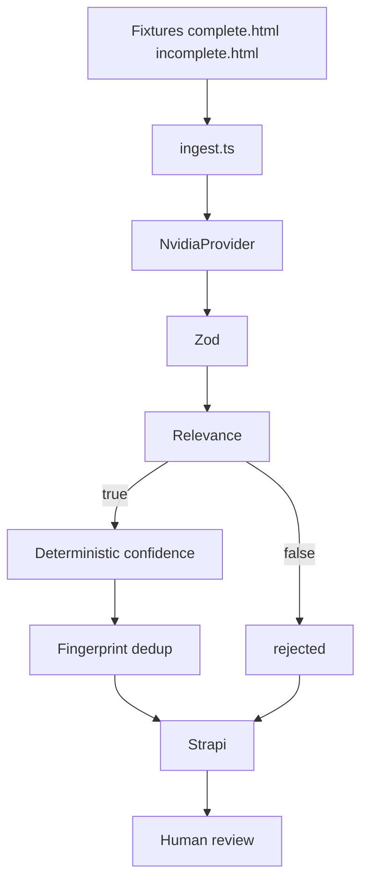
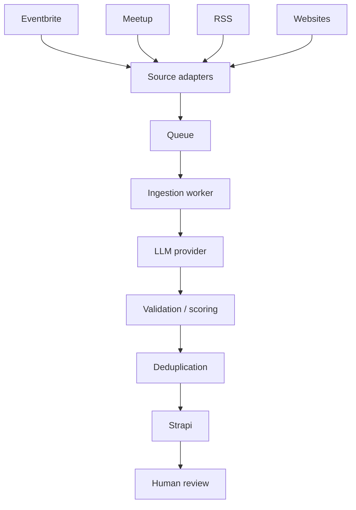

# Rooh experience ingest POC

**Submit:** [`docs/rationale.md`](docs/rationale.md) (diagram + ≤2-page rationale) and this folder.

One vertical slice: fixtures → extract → validate → relevance → confidence → dedup → Strapi → human review. Connectors, queues, and recommendations are designed, not built.

## Screen recording

Walkthrough of ingest + Strapi review (complete → `draft`, incomplete → `review`, second run → skip duplicate):

**[docs/demo.mp4](docs/demo.mp4)**

Drop the file there after you record (60–90s). Keep keys off screen. Recording may look idle while NVIDIA’s free endpoint is still generating — that wait is normal.

## POC pipeline (what this repo runs)



`url` is where a Rooh user goes to attend. `sourceUrl` is where we obtained the page. Ingest never writes `published`.

```
                 relevant?
                /        \
              no          yes
              ↓            ↓
          rejected     confidence
                         /      \
                       <.7      >=.7
                        ↓          ↓
                     review      draft
```

## Production evolution (not in this repo)



Each future connector emits the same HTML/text + `sourceUrl` the orchestrator already consumes. Fixtures stand in for that contract today.

## Assumptions

- V1 sources: `samplePages/complete.html`, `samplePages/incomplete.html`. Optional `--url` is a bonus path, not the demo.
- Rooh-relevant: retreats, workshops, coaching, mindfulness, wellness.
- Fingerprint: SHA-256 of `normalized(sourceUrl)|normalized(title)`.
- CMS: Strapi. Buy review UI.

## Setup

```bash
cp .env.example .env
npm install
```

NVIDIA API key + Strapi API token in `.env`.

Extraction uses **NVIDIA NIM on the free tier** (`meta/llama-3.3-70b-instruct`). There is no GPU bill, but the queue is shared, so each page often takes **tens of seconds to a couple of minutes**. That is expected. A paid NIM or OpenAI endpoint would be faster; the `LLMProvider` interface is there so the rest of the pipeline does not change.

### Strapi

```bash
npx create-strapi@latest cms --quickstart
cd cms && npm run develop
```

Collection **Experience** (`experiences`):

| Field | Type |
| --- | --- |
| title | Text |
| description | Long text |
| date | Text (optional) |
| location | Text (optional) |
| price | Decimal (optional) |
| url | Text (optional) |
| category | Text (optional) |
| sourceUrl | Text |
| relevant | Boolean |
| confidence | Decimal |
| fingerprint | Text, unique |
| state | Enumeration: `draft`, `review`, `published`, `rejected` |

API token with Experience find + create. No public write.

## Run

```bash
npm run typecheck
npm run check
npx ts-node src/ingest.ts
```

Complete fixture → `draft`. Incomplete → `review`. Re-run skips duplicates.

Ingest waits on the free NVIDIA endpoint — a long pause is not a hang. `[llm] response …ms` in the log is wall time for that call.

Optional: `npx ts-node src/ingest.ts --url https://example.com/event`

## Layout

```
src/config.ts
src/ingest.ts
src/providers/llm.ts
src/schemas/experience.ts
src/services/confidence.ts
src/services/dates.ts
src/services/deduplication.ts
src/services/strapi.ts
samplePages/
docs/rationale.md
docs/demo.mp4
```
