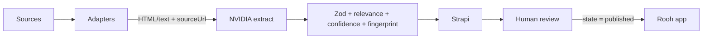

# Technical rationale

Rooh needs a path from public listings to a **reviewable** experience record—not a crawler and not recommendations. This POC is one vertical slice of that path.

## Architecture

**POC today:** fixtures (`complete.html`, `incomplete.html`) stand in for adapters. Same contract production would use.

**Later:** Eventbrite / Meetup APIs first (structured, fewer hallucinations), then partner RSS, then site fetch / Playwright only if needed. Adapters change; extract → process → CMS does not.

**Record:** `title`, `description`, `location`, `date`, `price`, `category`, `url` (book/attend), `sourceUrl` (where we fetched), plus `relevant`, `confidence`, `fingerprint`, `state` (`draft` | `review` | `published` | `rejected`).

The LLM fills content fields and `relevant`. It does **not** set `confidence`, `fingerprint`, or `state`.

## Approach

**Sourcing / collection.** Do not crawl the open web. Search Eventbrite and Meetup APIs by growth keywords + city; add partner RSS/iCal; fetch organizer HTML only when there is no API (Playwright if the page is JS-only). Each adapter emits `{ html or text, sourceUrl }`. This POC uses two HTML fixtures as that contract.

**Structuring.** Canonical fields above. `url` = book/attend; `sourceUrl` = provenance. Dates stay strings until `normalizeDate`; `"This Saturday"` → `null`.

**AI / automation.** NVIDIA NIM (OpenAI-compatible SDK) extracts JSON. Zod rejects bad shapes. Code then sets relevance routing, confidence, fingerprint, and `state`. Temperature 0 and JSON mode reduce format drift, not factual errors.

**CMS.** Strapi is the store and the review UI. API token: find + create only. Ingest `POST ?status=draft` so rows are not live on the public API.

**Human review.** Only a human sets workflow `published`. Reviewer opens `sourceUrl` beside the extraction, edits, publishes, or rejects.

**Bad data**

| Case | Handling | Human? |
|------|----------|--------|
| Incomplete / low-confidence | Missing date ×0.7, location ×0.8, price ×0.9; `< 0.7` → `review` | Yes — fill or reject |
| Conflicting (page vs extract, or two sources) | We do not auto-merge. Keep the first fingerprint; reviewer compares `sourceUrl` | **Yes** |
| Duplicate same URL+title | SHA-256 skip (drafts and published) | No |
| Same event, two domains | Not in V1 | Later / yes |
| Outdated | V1 has no re-fetch. Later: 404 or past `date` → flag unpublish | **Yes** |
| Hallucination / wrong facts | Zod for types/URLs; fluent lies can still score `1.0` → `draft`. Never auto-publish | **Yes** |
| Irrelevant | `rejected`, still stored | Spot-check |

## Decisions

**Buy** a hosted LLM (NVIDIA NIM via the OpenAI SDK) and **Strapi** (Content Manager is the review UI). **Build** the schema, Zod gate, deterministic confidence, URL+title fingerprint, and a small CLI.

The POC uses NVIDIA’s **free** NIM quota so it can run without an OpenAI bill. Free-tier traffic is rate-limited and queued, so extract is **slow** (often 30s–2min per page). That is a quota choice, not the pipeline. Swap in a paid model later; scoring and Strapi stay the same.

**Fixtures first** so the demo does not depend on Eventbrite keys or Cloudflare. **Code decides publish routing** so `src/check.ts` can assert scoring without calling the model. **Ingest never writes `published`.**

**Kept out of V1:** real connectors, queues, Playwright, embeddings, custom review app, recs.

## Trade-offs

Confidence measures *missing fields*, not *truth*. Fingerprints miss cross-site dupes. One LLM: outage stops ingest. **Free NVIDIA NIM:** no cost, high latency. No queue: fine for two pages, not for 10k.

## If I joined tomorrow

One Eventbrite or Meetup adapter on this same contract, plus a weekly cron—so the team gets a real review backlog. Recs and a second model wait until that queue exists.

---

**Demo:** [docs/demo.mp4](./demo.mp4). Complete fixture → `draft`; incomplete → `review`; re-run → skip duplicate. Strapi **Experience**: `state` + draft badge. Runbook: root `README.md`.
